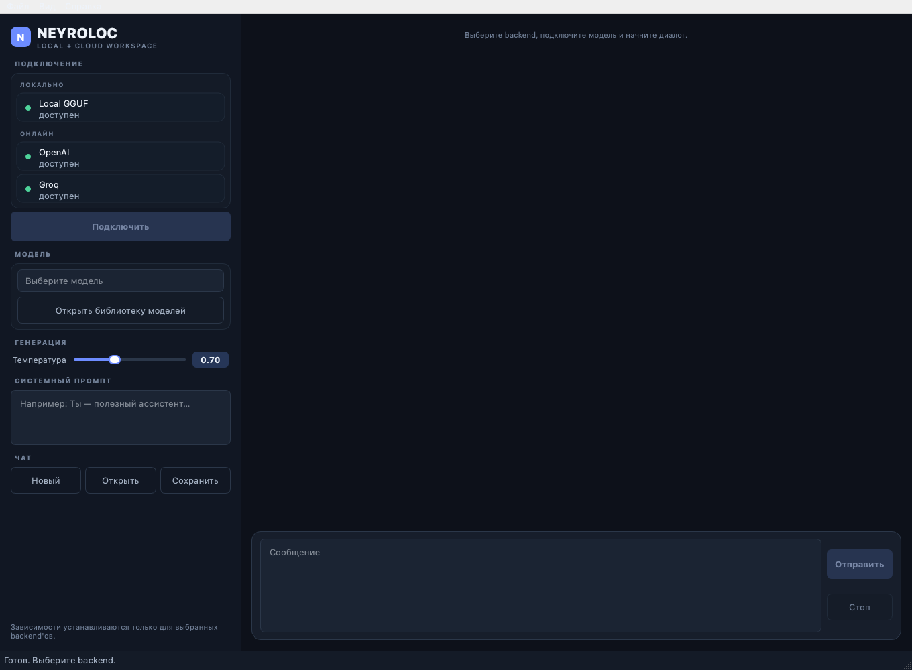

# NEYROLOC — нейросети на вашем компьютере

NEYROLOC — приложение с графическим интерфейсом для общения с локальными
GGUF-моделями и облачными моделями OpenAI / Groq. Вы можете скачать модель,
выбрать её в окне приложения, вести чат и подключить телефон к своему компьютеру.

**[Скачать текущие исходники ZIP](https://github.com/DorRyn-hub/NEYROLOC/archive/refs/heads/main.zip)** ·
**[Подробная установка](docs/INSTALL.md)** ·
**[Как пользоваться](docs/USER_GUIDE.md)** ·
**[Решение проблем](docs/TROUBLESHOOTING.md)**

> Сейчас на GitHub опубликованы исходники. Готовых установщиков в Releases пока
> нет: ZIP нужно распаковать, установить Python и выполнить шаги для своей системы.
> Файл «Source code.zip» тоже является исходниками, а не установщиком.
> Если хотите установку двойным щелчком без Python, такой вариант ещё не опубликован.

## С чего начать

| Ваше устройство | Куда перейти |
| --- | --- |
| Windows | [Установка на Windows](docs/INSTALL.md#windows) |
| Mac с M1 / M2 / M3 / M4 или более новым Apple Silicon | [Установка на macOS](docs/INSTALL.md#macos), затем [локальная модель](docs/INSTALL.md#local-model) |
| Mac с Intel | [Установка на macOS](docs/INSTALL.md#macos); для первой модели начните с CPU |
| Linux с графическим рабочим столом | [Установка на Linux](docs/INSTALL.md#linux) |
| Android / iPhone / iPad | Сначала установите приложение на компьютер; затем [подключите телефон через браузер](docs/USER_GUIDE.md#phone) |
| Приложение уже установлено | [Первый диалог](docs/USER_GUIDE.md#first-message), [обновление](docs/INSTALL.md#update) или [помощь](docs/TROUBLESHOOTING.md) |

GitHub-аккаунт для скачивания ZIP не нужен. PyCharm, Git и отдельная установка Qt
также не нужны для обычного запуска из ZIP.

## Быстрый маршрут

1. [Скачайте ZIP ветки main](https://github.com/DorRyn-hub/NEYROLOC/archive/refs/heads/main.zip).
2. Распакуйте его и назовите получившуюся папку `NEYROLOC`.
3. [Установите Python и зависимости для своей системы](docs/INSTALL.md).
4. Запустите `main.py` командой из инструкции. Должно открыться окно NEYROLOC.
5. Выберите, где выполнять запросы: [локально на компьютере](docs/INSTALL.md#local-model)
   или [через свой облачный API-ключ](docs/USER_GUIDE.md#cloud).
6. [Отправьте первое сообщение](docs/USER_GUIDE.md#first-message).

Для первого локального запуска начните с небольшой текстовой модели. Открытое
окно приложения ещё не означает, что модель скачана и загружена.

## Как выглядит приложение



Это окно текущих исходников с пустым профилем: личные настройки, ключи и чаты
в иллюстрации отсутствуют. Внешний вид на вашей системе может немного отличаться.

## Что нужно знать перед установкой

- **Локальный режим:** модель выполняется на вашем компьютере. Нужны отдельный
  файл `.gguf`, библиотека `llama-cpp-python`, память и место на диске. Интернет
  потребуется для установки и первоначального скачивания модели.
- **Облачный режим:** нужен ваш API-ключ и доступ к выбранному провайдеру.
  Запросы отправляются этому провайдеру; доступность, лимиты и стоимость зависят
  от вашего аккаунта. API-ключ автора приложения не предоставляется.
- **Телефон:** управляет моделью, которая работает на компьютере. Компьютер
  должен оставаться включённым, а приложение — запущенным.
- **Статус:** это развивающийся проект. Часть существующих тестов приложения
  не проходит; [известные ограничения](docs/TROUBLESHOOTING.md#limitations)
  описаны отдельно. Проверки сохранения исходников не являются проверкой всех
  функций приложения на всех устройствах.

## Если установка не получается

Начните с [таблицы ошибок](docs/TROUBLESHOOTING.md). Там разобраны ситуации
«Python не найден», «нет PySide6», «нет llama_cpp», проблемы компилятора,
пустой список моделей, недостаток памяти и подключение телефона.

Если решение не помогло, [создайте Issue](https://github.com/DorRyn-hub/NEYROLOC/issues/new)
по [шаблону обращения](docs/TROUBLESHOOTING.md#support). Не прикладывайте ключи,
личные чаты или файлы настроек.

## Для разработчиков

Активные исходники находятся в **main**. Ветка **version-control** — постоянный
центр восстановления и default branch GitHub; для клонирования приложения
явно указывайте `--branch main`.

```sh
git clone --branch main https://github.com/DorRyn-hub/NEYROLOC.git
```

| Каталог / файл | Назначение |
| --- | --- |
| `main.py`, `start.py`, `NEYROLOCK_5/` | Активное desktop-приложение |
| `NEYROLOC/` | Исходники iOS-обёртки |
| `packaging/android/` | Исходники Android-обёртки |
| `NEYROLOC_2/` | Архивный CLI и SDK |
| `docs/` | Инструкции для пользователей |
| `tests/` | Тесты проекта |
| `deploy/`, `remote/`, `packaging/` | Исходники инфраструктуры и сборки |

Сохранение и восстановление версий: [VERSIONING.md](VERSIONING.md).
Правила работы с исходниками: [AGENTS.md](AGENTS.md).
