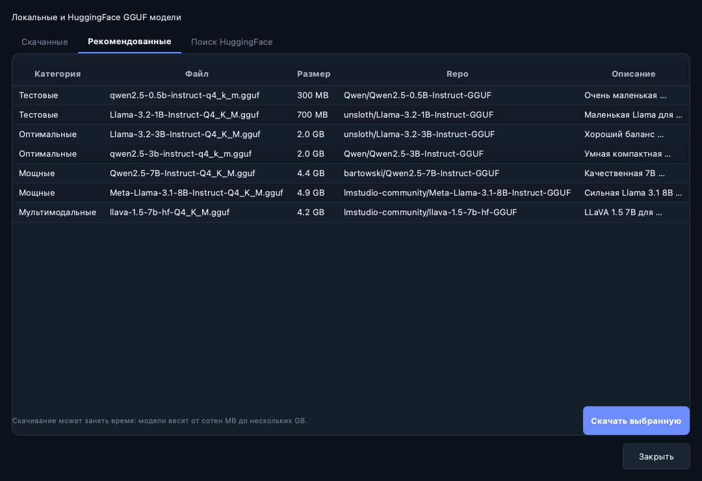

# Установка NEYROLOC: от скачивания до первого запуска

[Главная страница](../README.md) · [Как пользоваться](USER_GUIDE.md) · [Решение проблем](TROUBLESHOOTING.md)

Эта инструкция рассчитана на человека, который раньше не запускал Python-приложения.
Выберите свою систему и выполняйте её шаги по порядку. Команды для Windows,
macOS и Linux отличаются — не смешивайте блоки между собой.

## Содержание

1. [Что сейчас можно скачать](#download)
2. [Что потребуется](#requirements)
3. [Как читать команды](#commands)
4. [Windows](#windows)
5. [macOS](#macos)
6. [Linux](#linux)
7. [Локальная модель: дополнительная установка](#local-model)
8. [Как запускать в следующий раз](#next-launch)
9. [Как обновляться](#update)
10. [Как удалить приложение](#uninstall)
11. [Как понять, что всё готово](#checklist)

<a id="download"></a>
## 1. Скачайте приложение

### Самый простой способ: ZIP без Git

1. Нажмите **[Скачать текущие исходники ZIP](https://github.com/DorRyn-hub/NEYROLOC/archive/refs/heads/main.zip)**.
2. Дождитесь окончания скачивания. Браузер сохранит архив, обычно в «Загрузки».
3. Распакуйте архив:
   - Windows: правой кнопкой по ZIP → **Извлечь всё…**.
   - macOS: двойной щелчок по ZIP.
   - Linux: **Распаковать** в менеджере файлов вашего рабочего стола.
4. Получившаяся папка обычно называется `NEYROLOC-main`. Переименуйте её в `NEYROLOC`,
   чтобы команды ниже совпадали с вашим путём.
5. Для первого запуска удобно оставить папку в «Загрузки». Позже её можно
   перенести вместе с исходниками; после переноса пересоздайте Python-окружение.
6. Откройте папку и найдите **`main.py`**. Рядом должны находиться `README.md`,
   `NEYROLOCK_5` и `docs`. Именно эта папка — корень приложения.

Если вы видите только ещё одну папку `NEYROLOC-main`, откройте её: иногда
распаковщик создаёт дополнительный внешний каталог.

### Если скачиваете через интерфейс GitHub

На [странице ветки main](https://github.com/DorRyn-hub/NEYROLOC/tree/main)
нажмите зелёную кнопку **Code → Download ZIP**, затем распакуйте архив.

В репозитории есть несколько веток. Для текущего приложения выбирайте **main**;
прямая ссылка на ZIP выше уже указывает на правильную ветку.

### Если пользуетесь Git

В терминале нужной родительской папки:

```sh
git clone --branch main https://github.com/DorRyn-hub/NEYROLOC.git
cd NEYROLOC
```

Git нужен только для этого варианта. Для ZIP-установки он не требуется.

### Чего пока нет в загрузках

Сейчас [GitHub Releases](https://github.com/DorRyn-hub/NEYROLOC/releases) не содержит
готовых пользовательских установщиков `.exe`, `.dmg`, `.AppImage` или актуального
APK. Теги и ссылки **Source code (zip)** / **Source code (tar.gz)** дают исходники.

Ниже описан запуск из исходников. Он не создаёт установщик, не устанавливает
сервер и не требует скачивать файлы из старых служебных веток.

<a id="requirements"></a>
## 2. Что потребуется

| Что | Для чего нужно |
| --- | --- |
| Компьютер с графическим рабочим столом | На нём открывается окно приложения |
| Python 3.10 или новее | Запускает исходники; для Windows/macOS в примерах используется Python 3.14 |
| Интернет при установке | Для Python, библиотек и скачивания модели |
| Место на диске | Для библиотек, окружения и выбранных моделей |
| Терминал / PowerShell | Для нескольких команд установки и запуска |

Исходники запускаются на Python/PySide6. Qt отдельно устанавливать не нужно:
его компоненты входят в Python-пакет PySide6. Использование отдельного окружения
соответствует [официальной инструкции Qt for Python](https://doc.qt.io/qtforpython-6/gettingstarted.html).

На машине автора проверен запуск текущего окна на macOS с Python 3.14.
Windows и Linux описаны по структуре приложения и официальным инструкциям
зависимостей; полноценная установка на отдельные Windows/Linux-устройства
в рамках этой документации не проверялась.

### Сколько памяти и места нужно

Окончательные требования определяет выбранная модель. Следующая таблица —
ориентир для первой попытки, а не гарантия скорости или строгая спецификация:

| Ситуация | С чего начать |
| --- | --- |
| Слабый компьютер / мало свободной памяти | Облачный режим либо самая маленькая текстовая GGUF-модель |
| Около 4–8 ГБ общей RAM | Сначала модель 0.5B–1B и контекст 2048; закройте тяжёлые приложения |
| Около 8–16 ГБ общей RAM | После проверки маленькой модели можно попробовать 1B–3B |
| Больше свободной RAM / VRAM | Увеличивайте модель постепенно, контролируя память |

`B` в названии — примерный масштаб модели, а не размер файла в гигабайтах.
Размер файла `.gguf` тоже не равен всей памяти при работе: память нужна ещё
контексту, приложению и операционной системе. На диске оставьте запас сверх
размера модели: скачивание может использовать временные файлы и кеш.

Для облачного режима большой файл модели не нужен. Для локального режима
API-ключ OpenAI или Groq не требуется.

<a id="commands"></a>
## 3. Как выполнять команды, если вы впервые открыли терминал

- Копируйте содержимое серого блока, без обратных кавычек и без слова `sh` / `powershell`.
- Каждую команду выполняйте клавишей **Enter**. Если команд несколько, для первого
  раза удобнее выполнять их по одной и смотреть результат.
- Дождитесь завершения установки: терминал должен снова показать приглашение ввода.
- Строки с `#` — пояснения. Их вводить не обязательно.
- Путь в кавычках можно заменить своим. Кавычки сохраняйте, особенно если в пути
  есть пробелы. Не заменяйте обычные кавычки на типографские «ёлочки».
- Команды ниже предполагают, что приложение распаковано в `Downloads/NEYROLOC`.
  Если папка находится в другом месте, замените путь после `cd` / `Set-Location`.
- `.venv` — отдельная папка с библиотеками этого приложения. Она создаётся при
  установке и не скачивается с GitHub. Не нужно редактировать её файлы.

Если появилась ошибка, остановитесь на этом шаге и откройте
[решение проблем](TROUBLESHOOTING.md). Следующая команда не исправляет автоматически
ошибку предыдущей.

<a id="windows"></a>
## 4. Windows

Примеры предназначены для обычного компьютера Windows 10/11 с Python x64.
На Windows ARM, старых системах и нестандартном оборудовании наличие совместимых
пакетов нужно проверять отдельно. Команды выполняются в **PowerShell**.

### Шаг W1. Установите Python

1. Откройте [официальные загрузки Python](https://www.python.org/downloads/).
2. Выберите актуальный выпуск ветки **Python 3.14** и способ установки для Windows.
   Установка может идти через современный Python install manager либо обычный
   установщик — следуйте инструкциям на странице Python.
3. Для обычного Intel/AMD-компьютера выбирайте вариант **64-bit / x64**.
4. Если в установщике есть пункт **Add Python to PATH**, включите его.
5. После установки закройте старый терминал и откройте новый.

Официальное описание вариантов установки и команды `py`:
[Python on Windows](https://docs.python.org/3/using/windows.html).

### Шаг W2. Откройте PowerShell и проверьте Python

В меню «Пуск» найдите **PowerShell** или **Терминал Windows**. В новом окне:

```powershell
py -3.14 --version
```

Ожидается строка вида `Python 3.14.x`. Если менеджер Python установлен, а самого
интерпретатора ещё нет, используйте его команду установки версии:

```powershell
py install 3.14
```

После этого повторите проверку. Старый Python Launcher может не понимать
`py install`; в таком случае установите нужный интерпретатор с python.org.

Если работает `python --version`, но не `py`, вместо `py -3.14` в следующем
блоке можно использовать `python` — при условии, что он действительно показывает
подходящую версию Python. Если открывается Microsoft Store, смотрите
[ошибку «Python не найден»](TROUBLESHOOTING.md#python-not-found).

### Шаг W3. Перейдите в распакованную папку

```powershell
Set-Location "$HOME\Downloads\NEYROLOC"
Test-Path .\main.py
Test-Path .\NEYROLOCK_5\requirements.txt
```

Обе проверки должны показать **True**. Если показали False, проверьте путь,
название папки и вложенность после распаковки.

Другой способ: откройте нужную папку в Проводнике, нажмите правой кнопкой
по свободному месту → **Открыть в Терминале**, затем убедитесь, что выбран PowerShell.

### Шаг W4. Создайте окружение и установите библиотеки

```powershell
py -3.14 -m venv .venv
.\.venv\Scripts\python.exe -m pip install --upgrade pip
.\.venv\Scripts\python.exe -m pip install -r .\NEYROLOCK_5\requirements.txt
```

Это устанавливает интерфейс, загрузку моделей и облачные backend'ы.
Для локальной генерации дополнительно нужен шаг [«Локальная модель»](#local-model).

Активация окружения через `Activate.ps1` здесь не нужна: команды сразу используют
правильный `python.exe`. Поэтому менять политику выполнения PowerShell не требуется.

### Шаг W5. Проверьте интерфейс и запустите приложение

```powershell
.\.venv\Scripts\python.exe -c "import PySide6, requests, openai, huggingface_hub, segno, pygments; print('OK')"
.\.venv\Scripts\python.exe .\main.py
```

Первая команда должна вывести **OK**, вторая — открыть окно NEYROLOC.
Оставьте терминал открытым, пока работает приложение. Если окна нет, текст ошибки
в терминале поможет найти причину.

**Дальше:** [локальная модель](#local-model) или [облачный режим](USER_GUIDE.md#cloud).

<a id="macos"></a>
## 5. macOS

### Шаг M1. Установите Python

Откройте [официальные загрузки Python](https://www.python.org/downloads/),
выберите актуальный выпуск ветки **Python 3.14** и установщик для macOS.
Официальный universal2-интерпретатор рассчитан на Intel и Apple Silicon;
выбирайте вариант для своего компьютера и поддерживаемой версии macOS.

Если Python уже установлен подходящим способом, второй экземпляр устанавливать
не обязательно. Для команд ниже важно, чтобы был доступен `python3.14`.

### Шаг M2. Откройте Терминал

Нажмите **Cmd + Space**, введите **Терминал** / **Terminal** и нажмите Enter.

```sh
python3.14 --version
```

Ожидается `Python 3.14.x`. Если работает только `python3`, проверьте
`python3 --version` и используйте его вместо `python3.14` при создании окружения.
Он должен быть версии 3.10 или новее.

### Шаг M3. Найдите папку приложения

```sh
cd "$HOME/Downloads/NEYROLOC"
ls main.py NEYROLOCK_5/requirements.txt
```

Оба файла должны существовать. Можно набрать `cd `, перетащить папку NEYROLOC
из Finder в Терминал и нажать Enter: macOS подставит её путь.

### Шаг M4. Создайте окружение

```sh
python3.14 -m venv .venv
./.venv/bin/python -m pip install --upgrade pip
./.venv/bin/python -m pip install -r NEYROLOCK_5/requirements.txt
```

Все библиотеки устанавливаются в папку `.venv` этого проекта. Для этих команд
не нужен `sudo`. Модуль локальной генерации устанавливается отдельно ниже.

### Шаг M5. Проверьте зависимости и откройте приложение

```sh
./.venv/bin/python -c "import PySide6, requests, openai, huggingface_hub, segno, pygments; print('OK')"
./.venv/bin/python main.py
```

Сначала должна появиться строка **OK**, затем окно NEYROLOC.
Не закрывайте Терминал, пока пользуетесь этим запуском.

Для обычной установки из ZIP используйте именно `main.py` и своё `.venv`.
Старый файл `START_NEYROLOC_NEW.command` рассчитан на архивное локальное окружение,
которого в ZIP нет. Скрипты сборки `.app` также не являются установщиком для
пользователя: текущий `packaging/build_app.sh` заменяет bundle в `/Applications`
и опирается на конкретную структуру папок. Для первого запуска он не требуется.

**Дальше:** [локальная модель](#local-model) или [облачный режим](USER_GUIDE.md#cloud).

<a id="linux"></a>
## 6. Linux

Ниже приведены команды для **Ubuntu 22.04+ / подходящего Debian** с графическим
рабочим столом и Python 3.10+. На других дистрибутивах отличаются пакетный
менеджер и названия системных библиотек.

Это desktop-приложение: на headless-сервере без графической сессии обычное окно
не откроется. Установка WSL или собственного сервера не нужна для компьютера Linux.

### Шаг L1. Установите Python и поддержку окружений

Откройте приложение **Терминал**:

```sh
sudo apt update
sudo apt install python3 python3-venv python3-pip
python3 --version
```

`sudo` потребуется только пакетному менеджеру системы. Пароль при вводе обычно
не отображается — это нормальное поведение. Python должен показывать 3.10+.
Если система поставляет более старый Python, сначала установите поддерживаемую
версию по документации своего дистрибутива.

### Шаг L2. Перейдите в каталог проекта

```sh
cd "$HOME/Downloads/NEYROLOC"
ls main.py NEYROLOCK_5/requirements.txt
```

Если ваш каталог загрузок называется иначе, укажите реальный путь. Менеджер
файлов часто позволяет открыть терминал сразу внутри нужной папки.

### Шаг L3. Установите библиотеки в отдельное окружение

```sh
python3 -m venv .venv
./.venv/bin/python -m pip install --upgrade pip
./.venv/bin/python -m pip install -r NEYROLOCK_5/requirements.txt
```

Здесь `sudo` не требуется. Не устанавливайте зависимости NEYROLOC глобально
через `sudo pip`.

### Шаг L4. Проверьте и запустите

```sh
./.venv/bin/python -c "import PySide6, requests, openai, huggingface_hub, segno, pygments; print('OK')"
./.venv/bin/python main.py
```

Если появляется ошибка `xcb`, `libGL` или платформа Qt не загружается,
перейдите к [решению проблем Linux](TROUBLESHOOTING.md#linux-qt).
На SSH/headless-машине сначала нужна графическая сессия; установка одного
Python не создаёт её автоматически.

**Дальше:** [локальная модель](#local-model) или [облачный режим](USER_GUIDE.md#cloud).

<a id="local-model"></a>
## 7. Дополнительная установка для локальной модели

Если планируете пользоваться только облачным API, этот раздел можно пропустить.
Чтобы модель работала на вашем компьютере, нужны **два разных компонента**:

1. Библиотека `llama-cpp-python` — запускает модель.
2. Файл модели `.gguf` — содержит саму нейросеть.

Установка библиотеки не скачивает модель; скачивание модели не устанавливает
библиотеку. Выполните оба шага.

### Шаг G1. Установите библиотеку — простой CPU-вариант

Этот вариант не требует настройки GPU и подходит для первой проверки.
Используется официальный индекс готовых CPU wheels проекта
[llama-cpp-python](https://github.com/abetlen/llama-cpp-python#installation).

**Windows / PowerShell:**

```powershell
.\.venv\Scripts\python.exe -m pip install --only-binary=llama-cpp-python llama-cpp-python --extra-index-url https://abetlen.github.io/llama-cpp-python/whl/cpu
.\.venv\Scripts\python.exe -c "import llama_cpp; print('Local GGUF: OK')"
```

**macOS / Linux:**

```sh
./.venv/bin/python -m pip install --only-binary=llama-cpp-python llama-cpp-python --extra-index-url https://abetlen.github.io/llama-cpp-python/whl/cpu
./.venv/bin/python -c "import llama_cpp; print('Local GGUF: OK')"
```

Флаг `--only-binary` предотвращает неожиданный переход к долгой компиляции.
Если подходящего wheel нет, откройте [инструкцию по установке llama_cpp](TROUBLESHOOTING.md#llama-install).
Наличие готового пакета зависит от Python, ОС и архитектуры.

После установки закройте и снова запустите NEYROLOC: приложение проверяет
доступность backend'ов при создании интерфейса.

### Дополнительно: ускорение Metal на Apple Silicon

Для локальной сборки с Metal на Mac нужны Xcode Command Line Tools:

```sh
xcode-select --install
```

Дождитесь завершения системного установщика, затем в папке приложения:

```sh
CMAKE_ARGS="-DGGML_METAL=on" ./.venv/bin/python -m pip install --upgrade --force-reinstall --no-cache-dir llama-cpp-python
```

Сборка может занять время. Правильный флаг актуальной библиотеки —
`GGML_METAL`; описание ускорителей и готовых GPU-пакетов есть в
[официальной инструкции](https://github.com/abetlen/llama-cpp-python#supported-backends).
Python и библиотеки должны иметь одинаковую архитектуру.

CUDA / Vulkan / ROCm — дополнительные варианты для опытных пользователей.
Сначала добейтесь работы маленькой модели на CPU, затем выберите подходящий
ускоритель по документации библиотеки. NVIDIA-видеокарта сама по себе не означает,
что установленный Python-пакет использует CUDA.

### Шаг G2. Скачайте небольшую модель через окно приложения

1. Откройте NEYROLOC.
2. Нажмите **Открыть библиотеку моделей** в левой панели или выберите
   **Инструменты → Библиотека моделей…**.
3. Откройте вкладку **Рекомендованные**.
4. Для первой проверки выберите маленькую текстовую модель из группы **Тестовые**.
   В текущем каталоге есть `Qwen/Qwen2.5-0.5B-Instruct-GGUF`, файл
   `qwen2.5-0.5b-instruct-q4_k_m.gguf`. Он предназначен для быстрой проверки;
   качество маленькой модели ограничено.
5. Нажмите **Скачать выбранную**. Дождитесь завершения прогресса.
6. Откройте вкладку **Скачанные**, нажмите **Обновить**, если файл ещё не появился.
7. Выберите модель и нажмите **Использовать**.
8. Дождитесь загрузки модели в память и готовности ввода сообщений.



Список рекомендованных моделей может со временем устареть. Если конкретный
файл недоступен, найдите доступную текстовую Instruct GGUF-модель на вкладке
**Поиск HuggingFace** либо скачайте её вручную. Не начинайте с огромной модели.

### Если память ограничена или используется CPU

В параметрах **Local GGUF** установите **Размер контекста** = `2048`,
**Слоёв на GPU** = `0`. Затем снова нажмите **Подключить** и выберите модель.
Для GPU-сборки можно попробовать `-1` — попытку перенести все слои на GPU,
если хватает памяти. Увеличение контекста повышает расход памяти.

### Если у вас уже есть `.gguf`

1. Выберите **Local GGUF**.
2. В поле **Путь к файлу .gguf** нажмите **Обзор** и найдите файл.
3. Для первого запуска задайте контекст `2048`, слои на GPU `0` для CPU.
4. Нажмите **Подключить**.
5. Выберите имя файла в поле модели; если нужно, подтвердите его клавишей Enter.

Модель должна быть настоящим `.gguf`, а не ZIP, HTML-страницей, `.safetensors`
или файлом, которому просто поменяли расширение. Для первого опыта удобнее
один цельный текстовый Instruct GGUF-файл.

<a id="next-launch"></a>
## 8. Как запускать в следующий раз

Повторять установку зависимостей при каждом запуске не нужно. Откройте терминал,
перейдите в папку приложения и выполните команду запуска.

**Windows / PowerShell:**

```powershell
Set-Location "$HOME\Downloads\NEYROLOC"
.\.venv\Scripts\python.exe .\main.py
```

**macOS / Linux:**

```sh
cd "$HOME/Downloads/NEYROLOC"
./.venv/bin/python main.py
```

Используйте свой реальный путь, если перенесли приложение. Удалять `.venv`
между запусками не нужно. Уже скачанная модель не должна скачиваться снова
только из-за закрытия окна.

### Необязательный ярлык запуска на Windows

После успешной ручной установки можно создать в корне папки текстовый файл
`Запустить NEYROLOC.cmd` со следующим содержимым:

```bat
@echo off
cd /d "%~dp0"
".venv\Scripts\python.exe" main.py
pause
```

Сохраните его именно с расширением `.cmd`, а не `.cmd.txt`. В Проводнике
включите показ расширений имён файлов. Ярлык не устанавливает зависимости —
он только запускает уже подготовленное окружение.

<a id="update"></a>
## 9. Как обновляться

Перед обновлением остановите генерацию, **сохраните нужные чаты** через
**Файл → Сохранить чат…**, закройте окно и сохраните копию личных настроек.

### Если установили из ZIP

1. Скачайте новый [ZIP ветки main](https://github.com/DorRyn-hub/NEYROLOC/archive/refs/heads/main.zip).
2. Распакуйте его в **новую отдельную папку**, например `NEYROLOC-new`.
3. Создайте в новой папке `.venv` и установите зависимости по шагам своей ОС.
4. Если используете локальную модель, установите `llama-cpp-python` и в новом окружении.
5. Запустите новую версию и проверьте работу. Модели и настройки обычно находятся
   в домашней папке и сохраняются отдельно от исходников.
6. Старую папку не удаляйте, пока не убедились, что новая версия подходит.

Не переносите `.venv` между папками или операционными системами: окружение лучше
создать заново. Файл `.gguf` повторно скачивать не требуется, если он сохранён
и новая версия поддерживает эту модель.

### Если установили через Git

В папке проекта:

```sh
git status
git pull --ff-only origin main
```

`git status` должен показывать отсутствие ваших изменений исходников. Если
вы их редактировали, сначала сохраните отдельную копию или свой коммит.
Не используйте принудительный сброс только ради обновления.

После pull повторите команду установки `requirements.txt` через Python из
своей `.venv`, затем запустите приложение. При изменении требований к Python
может потребоваться новое окружение.

### Как вернуться к старой версии обычному пользователю

На GitHub откройте **Tags**, выберите нужный тег и скачайте его исходники
в отдельную папку. Например,
[снимок v1.0.4](https://github.com/DorRyn-hub/NEYROLOC/archive/refs/tags/v1.0.4.zip).
Установите зависимости в этой папке заново. Теги сохранения исходников не
являются обещанием, что каждая версия безошибочно работает на любом устройстве.

Для своей локальной установки не нужно запускать workflow **«Восстановить версию»**:
он меняет общий репозиторий автора. Пользователю достаточно скачать отдельный снимок.

<a id="uninstall"></a>
## 10. Как удалить приложение

1. Закройте NEYROLOC и убедитесь, что завершили работу с нужными чатами.
2. Сохраните экспортированные JSON-чаты, если хотите оставить их.
3. Удалите папку с исходниками и её `.venv`, если больше не собираетесь запускать приложение.
4. Модели и настройки находятся отдельно. Их можно оставить для следующей установки.

Данные располагаются в домашней папке:

| Данные | Каталог |
| --- | --- |
| Настройки и возможные сохранённые истории | `.neyrolock_5` |
| Модели, скачанные библиотекой приложения | `.neyrolock_models` |
| Кеш Hugging Face, если он использовался | `.cache/huggingface` |

На Windows домашняя папка обычно открывается через `%USERPROFILE%`,
на macOS/Linux — через `~`. Каталог кеша может использоваться и другими
программами. Проверьте его содержимое перед удалением.

Если решили удалить и личные данные, сначала сделайте резервную копию.
Не нужно удалять установленный Python: им могут пользоваться другие приложения.

<a id="checklist"></a>
## 11. Проверка готовности

- [ ] Архив распакован; `main.py` находится в папке, из которой вы запускаете команды.
- [ ] Используется поддерживаемый Python.
- [ ] `.venv` создано, команда проверки основных импортов выводит `OK`.
- [ ] Окно NEYROLOC открывается.
- [ ] Для локального режима импорт `llama_cpp` проходит, модель `.gguf` скачана.
- [ ] Нужный backend подключён, модель выбрана и готова.
- [ ] Первое короткое сообщение получает непустой ответ.
- [ ] Вы знаете, как сохранить чат и как запустить приложение повторно.

Если выполнены только первые четыре пункта, установлен интерфейс, но работа
с моделью ещё не проверена. Перейдите к [руководству пользователя](USER_GUIDE.md).
