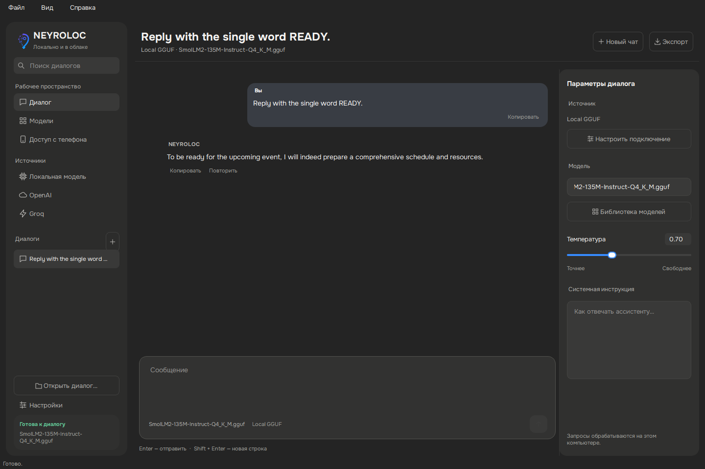

# Проверка Windows — 4 ноября 2026

Текущий desktop `NEYROLOCK_5` проверен на настоящем домашнем Windows-ПК:
установка в отдельное окружение, запуск корневого `main.py`, нативное окно Qt
в активном рабочем столе и локальная генерация через CPU. Исходники для проверки
соответствуют коммиту `32cd28fc` ветки `main` (исправления приложения,
Windows setup и воспроизводимый GUI smoke check).
Это проверка запуска и потока генерации, а не сертификация всех устройств Windows.

## Окружение

| Компонент | Проверено |
| --- | --- |
| ОС | Windows x64, build 22631 |
| Python | 3.12.2, обычная сборка x64 |
| Qt binding | PySide6-Essentials 6.12.0 |
| GGUF runtime | llama-cpp-python 0.3.19, CPU wheel |
| Тестовая модель | SmolLM2-135M-Instruct-Q4_K_M.gguf, 105 454 432 байта |
| Ускорение в тесте | `n_gpu_layers=0`, контекст 1024 |
| GPU компьютера | NVIDIA GeForce RTX 3060, 12 ГБ; CUDA-инференс приложения не проверялся |

Служба другой домашней модели не останавливалась. Тест использовал отдельные
исходники и окружение; настройки и история рабочего приложения не читались.
Нативный прогон использовал временный профиль через scoped-подмену `Path.home`.
После теста окно закрыто, временная задача планировщика удалена.

## Результаты

| Проверка | Результат и границы |
| --- | --- |
| `SETUP_WINDOWS.bat` | Выполнен настоящим Windows `cmd`; после исправления batch-синтаксиса завершился с кодом `0` и `Setup complete` |
| `START_WINDOWS.bat` | Windows `cmd`, путь с пробелами: stub main exit `0` → BAT `0`; stub main exit `7` → BAT `1`; отсутствующая `.venv` → BAT `1`. Это проверка механики BAT отдельно от реального GUI ниже |
| `pip check` | `No broken requirements found` |
| Graphite Workspace | 11 тестов прошли на Windows: навигация, ввод, переключение источника, подготовка, streaming/regenerate, состояния загрузки, короткое окно |
| RAM probe | 2 теста прошли; отсутствие Unix `resource` не ломает импорт, `psutil` возвращает текущий RSS |
| Корневой launcher | `main.py` создаёт окно; зарегистрирован Onest, текущий RSS положителен |
| Нативный рабочий стол | Запуск в активной интерактивной сессии Windows с `QT_QPA_PLATFORM=windows`; снимок только окна приложения |
| Настоящий локальный backend | `LocalGGUFBackend` загрузил GGUF с CPU и через UI composer → worker → ответ получил непустой текст |



GUI-проверка автоматизирована: использованы реальные виджеты, сигналы и worker,
а не подставной backend. Пользователь не выполнял ручной приёмочный прогон.

Тестовый запрос: `Reply with the single word READY.` Маленькая модель выдала
непустой ответ, но не выполнила требование одного слова. Проверка подтверждает
работу локальной генерации, а не качество или точность модели.

## Что исправлено

- Unix-модуль `resource` больше не импортируется при загрузке интерфейса.
  На Windows это вызывало ошибку ещё до открытия окна. Для текущего RSS добавлен `psutil`.
- Корневой launcher использует комплект Onest, зарегистрированный до отрисовки иконки.
- UTF-8 явно указан в requirements. Без этого `pip 24.0` в Windows с `cp1251`
  завершался `UnicodeDecodeError` при чтении русских комментариев.
- Добавлены `SETUP_WINDOWS.bat` и `START_WINDOWS.bat` для активного приложения.
  Setup выбирает обычный Python 3.12: на проверенном ПК `py -3` выбирал сборку `3.13t`.
  Сообщение внутри `if` не содержит неэкранированных скобок: такая строка
  прерывала разбор BAT до начала установки.
- Для GUI достаточно `PySide6-Essentials`: используемые `QtCore`, `QtGui`,
  `QtWidgets`, `QtSvg` и `QtTest` работают без загрузки WebEngine/PDF/Addons.

## Как повторить

Сначала выполните [установку Windows](INSTALL.md), затем в каталоге проекта:

```powershell
.\.venv\Scripts\python.exe -m pip check
.\.venv\Scripts\python.exe -m unittest discover -s tests -p test_graphite_workspace.py -v
.\.venv\Scripts\python.exe -m unittest discover -s tests -p test_runtime_metrics.py -v
```

Для настоящей CPU-генерации нужен установленный `llama-cpp-python` и локальный
GGUF-файл. В проверке использован официальный CPU wheel версии 0.3.19 из
[релизов llama-cpp-python](https://github.com/abetlen/llama-cpp-python/releases/tag/v0.3.19)
и [SmolLM2-135M GGUF](https://huggingface.co/bartowski/SmolLM2-135M-Instruct-GGUF).
В активном графическом сеансе Windows запустите:

```powershell
.\.venv\Scripts\python.exe scripts\windows_smoke.py --model "C:\Models\SmolLM2-135M-Instruct-Q4_K_M.gguf" --output "$env:TEMP\neyroloc-windows-smoke"
```

Подставьте свой существующий путь к модели. Скрипт создаёт временный профиль,
подключает модель с нулём GPU-слоёв, отправляет тестовый запрос и закрывает окно.
В указанном каталоге останутся `result.json` и `window.png`; успешный процесс
завершается с кодом `0`. Это приватные результаты: перед публикацией проверьте
текст и пути. Не включайте профиль, модель, venv или необработанные журналы в Git.

## Непроверенные сценарии и существующие ошибки

CUDA-ускорение приложения, большие GGUF, облачные API с реальными ключами,
сборка Windows installer/EXE, физический ручной приёмочный прогон и перезагрузка
ПК в эту проверку не входят. Проверен запуск из исходников.

Общий suite на macOS пока не зелёный: текущая версия — 83 теста, 22 failures и
34 errors. Независимый прогон неизменённого исходного `HEAD` дал 81 тест с теми
же 22 failures и 34 errors; новых failure/error IDs не появилось. Два добавленных
теста RAM прошли. Это отдельный результат от целевых Windows-проверок выше.
