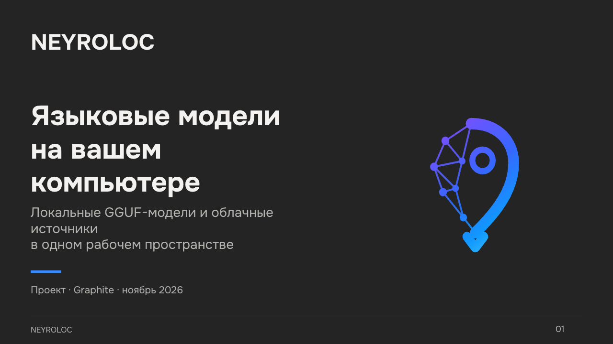

# Презентация NEYROLOC · Graphite

[Скачать PowerPoint](NEYROLOC-Graphite.pptx) · [Руководство пользователя](../USER_GUIDE.md) · [Установка](../INSTALL.md)

20 слайдов, формат 16:9. Текст и схема архитектуры редактируются в PowerPoint;
снимки интерфейса встроены как изображения. Используется текущая палитра
`NEYROLOCK_5/ui/styles.py` и шрифт Onest.

Для сохранения оформления установите [Onest Regular и Bold](../../NEYROLOCK_5/resources/fonts/)
перед открытием презентации. Файлы `.ttf` открываются двойным щелчком;
затем выберите установку шрифта в своей ОС. При отсутствии Onest редактор
может заменить его системным шрифтом и изменить переносы строк.

## Содержание

1. NEYROLOC — языковые модели на вашем компьютере
2. О проекте
3. Зачем запускать модель локально
4. Задача проекта
5. Рабочее пространство Graphite
6. Локально или через API
7. Что реализовано
8. Место проекта
9. Архитектура приложения
10. Границы приватности
11. Доступ с телефона
12. Библиотека GGUF-моделей
13. Выбор модели под компьютер
14. Что проверяем
15. Параметры и ресурсы
16. Первый запуск
17. Где проект полезен
18. Дальнейшее развитие
19. Результат проекта
20. Исходники и руководство

## Основа содержания

Описание относится к активному desktop-приложению `NEYROLOCK_5`, а не к архивному
CLI. Снимки Graphite получены с временным профилем и тестовым backend без личных
чатов и ключей. Они показывают интерфейс; результаты настоящего Windows-запуска
фиксируются отдельно в [отчёте проверки](../WINDOWS_VALIDATION.md).

Архитектура и возможности сверены с исходниками. Презентация не приводит
неизмеренные скорости генерации, результаты нагрузочных испытаний или обещания
работоспособности на любом оборудовании. Связь с телефоном требует включённого
компьютера. Облачный режим передаёт запросы выбранному провайдеру.

Технические источники указаны также в заметках слайдов:

- [Qt for Python](https://doc.qt.io/qtforpython-6/)
- [llama-cpp-python](https://github.com/abetlen/llama-cpp-python)
- [Hugging Face Hub](https://huggingface.co/docs/huggingface_hub/index)
- [Устройство приложения](../DEVELOPER_GUIDE.md)

Оформление и содержание обновлены 4 ноября 2026 года. Презентация проверена
путём рендеринга всех слайдов и проверки структуры PPTX; отдельное открытие
в Microsoft PowerPoint не выполнялось.
